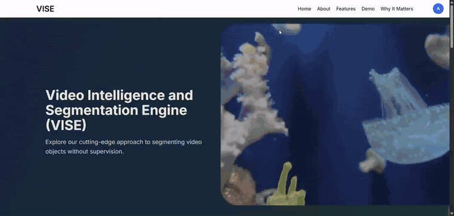
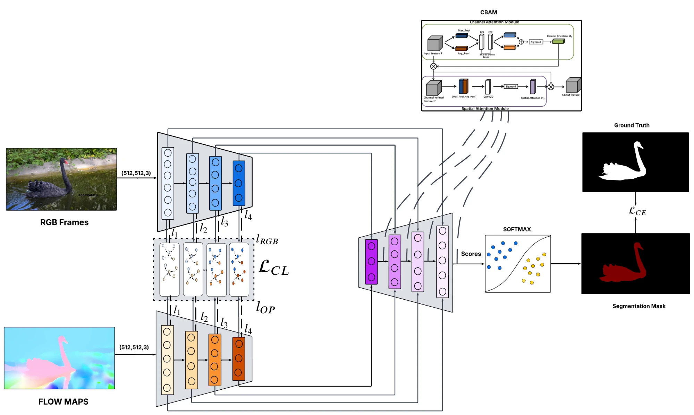

# 🎥 UVOS: Unsupervised Video Object Segmentation

A research-focused framework for **Unsupervised Video Object Segmentation (UVOS)** using **contrastive learning** on benchmark datasets including **DAVIS**, **FBMS**, and **YT-OBJ**.

### VISE web app

**VISE (Video Intelligence and Segmentation Engine)** is the web application built on this
framework: upload a video, VISE segments the moving objects, and the result can be played
back and downloaded as a video or image.

[Watch the full demo (MP4)](demo/vise-demo.mp4)

### Segmentation result

## 🧠 Key Idea

We aim to segment primary foreground objects in videos without manual annotations, leveraging:
- Temporal consistency  
- Appearance contrastive features  
- Flow-guided supervision  
- No ground-truth masks required

## 🏗️ Architecture

- **Two-stream encoder.** RGB frames and their optical-flow maps (512 × 512 × 3) are encoded
  by two parallel encoders, each producing features at four levels (l1 to l4).
- **Cross-modal contrastive learning.** At every level, the appearance (RGB) and motion
  (flow) features are aligned with a contrastive loss (L_CL), so the network learns which
  regions move together as one object.
- **Attention-guided decoder.** Skip connections from both encoders feed a decoder refined
  by CBAM (Convolutional Block Attention Module): channel attention followed by spatial
  attention.
- **Output.** The decoder's scores pass through a softmax to produce the segmentation
  mask, compared with the reference mask through a cross-entropy loss (L_CE).

## 🛠️ Tech Stack

- Python, PyTorch  
- RAFT for Optical Flow

## 📂 Datasets Used

- [DAVIS 2016](https://davischallenge.org/davis2016/code.html)  
- [FBMS](https://github.com/tfzhou/ASE-Fast)  
- [DUTS](https://dut-omron.github.io/DUTS)  
- [YouTube-Objects](https://github.com/liulu112601/MBNM)

**FINAL CODE COMING SOON!**
